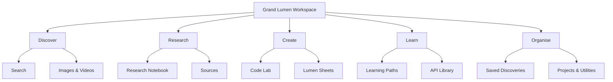

#  Grand Lumen

<div align="center">

  

  **A modular digital workspace for discovery, research, learning, coding and productivity.**

  <p>
    <a href="https://junior-pobee.github.io/Grand-Lumen/"></a>
    <a href="https://github.com/junior-pobee/Grand-Lumen/actions"></a>
    <a href="https://github.com/junior-pobee/Grand-Lumen"></a>
  </p>

  <sub>Designed to bring useful digital tools into one connected experience.</sub>

</div>

---

## ✦ The experience

Grand Lumen brings multiple everyday digital workflows together in one responsive interface. Move from finding information to organising ideas, experimenting with code, exploring visual media and working with data without treating every task as a separate destination.

<div align="center">
  
</div>

## ✦ Workspace highlights

| Workspace | What it offers |
| --- | --- |
| **Search & Discovery** | Search experiences for Wikipedia and Hacker News, with results presented inside the app. |
| **Research Lab** | Research notebook and source discovery to help organise findings. |
| **Visual Discovery** | Image discovery through Wikimedia Commons and public video discovery with embedded Internet Archive previews. |
| **Code Lab** | Multi-language code starters and an in-app HTML/JavaScript preview. |
| **Learning Paths** | Guided foundations for web development, programming and data concepts. |
| **Lumen Sheets** | A spreadsheet workspace with editable cells, formula support, import/export options, adjustable row and column counts, and an expandable full-screen view. |
| **API Library** | A catalogue of 20 public and developer APIs. |
| **Live Utilities** | Weather, currency, dictionary, Pokémon and public-holiday tools. |
| **Personal Workspace** | Saved discoveries and a personal project list. |
| **Personalisation** | Dark and light themes with a responsive layout. |

## ✦ Visual direction

The interface is built around a clean workspace aesthetic:

- **Focused surfaces** — clear content areas that keep tools and results readable.
- **Responsive layout** — adapts across phone, tablet and desktop widths.
- **Theme flexibility** — dark and light appearance options.
- **Motion with purpose** — loading feedback and interface transitions support navigation without becoming the content.
- **Expandable work areas** — Lumen Sheets can expand to use the available screen space and return to its normal view.

## ✦ How the platform fits together

The diagram below shows the main product areas and how they sit within the workspace.



## ✦ Technology

<div align="center">
  
</div>

- **Application:** React, TypeScript and Vite
- **Styling:** CSS
- **Tooling:** Node.js and npm
- **Planned service capabilities:** Python for research and data processing
- **Planned data layer:** PostgreSQL and Supabase for account and synchronised workspace capabilities
- **Performance direction:** Rust and WebAssembly for selected performance-sensitive features

## ✦ Run locally

You’ll need a current Node.js LTS release and npm.

```bash
git clone https://github.com/junior-pobee/Grand-Lumen.git
cd Grand-Lumen
npm install
npm run dev
```

Create and preview a production build:

```bash
npm run build
npm run preview
```

## ✦ Deployment

Grand Lumen is published through GitHub Pages using the repository's GitHub Actions workflow.

- **Live application:** [Open Grand Lumen](https://junior-pobee.github.io/Grand-Lumen/)
- **Source repository:** [View the GitHub repository](https://github.com/junior-pobee/Grand-Lumen)
- **Deployment workflow:** [View deployment runs](https://github.com/junior-pobee/Grand-Lumen/actions)

## ✦ Current implementation notes

- Lumen Sheets stores its workbooks locally in the browser. Local workbooks do not automatically synchronise between devices, so export important work for backup.
- Some API providers are catalogued for future integration and may require credentials before they can be used.
- The Code Lab provides language starters and a browser-based HTML/JavaScript preview. Running languages such as Python, C, Java and Rust requires a secure execution service and is not represented as native browser execution.
- Research findings should be checked against the original sources.
- Features described as planned are part of the technical direction, not a claim that those services are already active.

## ✦ Project boundary

Grand Lumen is developed independently from the original Lumen repository. Work in this repository does not modify the separate Lumen project.

---

<div align="center">

  **Built by Emmanuel Pobee Okpoti**

  *Explore ideas. Build knowledge. Create possibilities.*

  <a href="https://junior-pobee.github.io/Grand-Lumen/">Launch Grand Lumen ↗</a>

</div>
